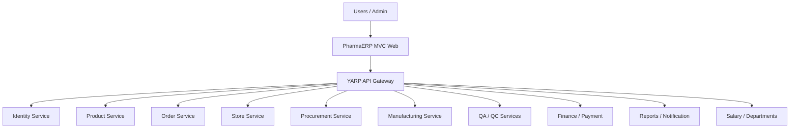

# PharmaERP – Pharmaceutical ERP Management System

**Enterprise Pharmaceutical Manufacturing & Business Management Platform**

PharmaERP is a microservices-based ERP application designed to manage pharmaceutical business operations, including product management, procurement, inventory, manufacturing, quality control, orders, finance, and reporting.

## Dashboard Preview


## Technology Stack

- **Backend:** C#, ASP.NET Core Web API, .NET 10
- **Frontend:** ASP.NET Core MVC, HTML5, CSS3, Bootstrap, JavaScript, jQuery
- **Database:** Microsoft SQL Server, Entity Framework Core
- **Architecture:** Microservices, REST APIs, YARP API Gateway
- **Security:** OAuth 2.0, OpenID Connect, JWT
- **Caching:** Redis
- **Testing:** xUnit, Integration Testing
- **Tools:** Visual Studio, Swagger, Git, GitHub

## Architecture



## Business Microservices

| Service | Responsibilities |
|---|---|
| Identity | Authentication, users, roles, permissions |
| Product | Product master, categories, raw materials, finished goods |
| Order | Purchase orders, sales orders, approvals |
| Store | Warehouse, inventory, batches, expiry, stock ledger |
| Procurement | Suppliers, requisitions, purchasing |
| Manufacturing | Production planning, BOM, batch production |
| Quality Assurance | Quality review, verification, batch release |
| Quality Control | Material inspection, laboratory testing |
| Finance | Invoices, GST, accounts payable/receivable, ledger |
| Payment | Supplier payments, customer receipts |
| Salary | Employee payroll and salary processing |
| Reports | Business and operational reports |
| Notification | Alerts, email and notifications |
| Departments | Department and employee administration |

## Business Workflow

```mermaid
flowchart LR
    A[Product Master] --> B[Procurement]
    B --> C[Purchase Order]
    C --> D[Goods Receipt]
    D --> E[Inventory]
    E --> F[Manufacturing]
    F --> G[QC Testing]
    G --> H[QA Approval]
    H --> I[Finished Goods]
    I --> J[Sales Order]
    J --> K[Dispatch]
    K --> L[Invoice]
    L --> M[Payment]
```



## Department Dashboards

Each department has its own dashboard with KPI cards, searchable data grids, filters, sorting, pagination, and role-based operations.

- Executive Dashboard
- Product Dashboard
- Order Dashboard
- Store Dashboard
- Procurement Dashboard
- Manufacturing Dashboard
- QA Dashboard
- QC Dashboard
- Finance Dashboard
- Payment Dashboard
- Salary Dashboard
- Reports Dashboard
- Department Dashboard

## Local Development URLs

| Application | URL |
|---|---|
| MVC Web | http://localhost:7300 |
| API Gateway | http://localhost:7200 |
| Identity | http://localhost:7001 |
| Dashboard API | http://localhost:7101 |
| Product API | http://localhost:7301 |
| Order API | http://localhost:7302 |
| Store API | http://localhost:7303 |
| Finance API | http://localhost:7305 |

Other service ports are documented in the solution configuration.

## Getting Started

```bash
git clone https://github.com/asifsys/PharmaERP.git
cd PharmaERP
dotnet restore
dotnet build
dotnet test
```

Configure SQL Server connection strings and required secrets before running the services. Apply the migrations for each service independently.

## Repository

[GitHub – PharmaERP](https://github.com/asifsys/PharmaERP)

## Project Vision

To build a scalable, secure, and integrated pharmaceutical ERP platform that connects every department and provides complete business and operational traceability.

**Built with .NET Microservices Architecture.**